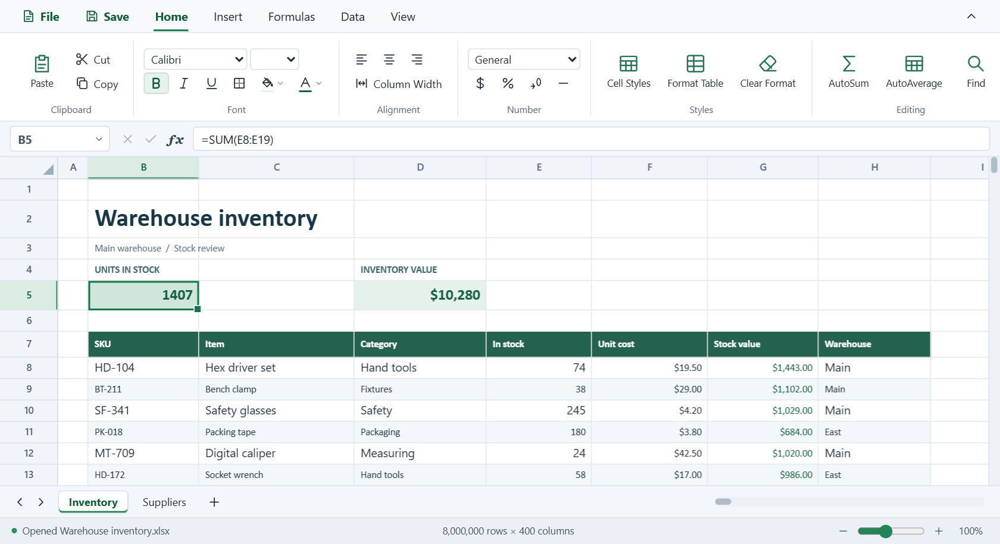

# Grids&Tabs

**Open a spreadsheet, edit it and save it without leaving VS Code.** Grids&Tabs works offline with XLSX workbooks, native `.gridsntabs` workbooks and delimited text files.

## Open, edit and save

1. **Open a file.** Right-click an XLSX, `.gridsntabs`, CSV, TSV or TXT file in the VS Code Explorer and choose **Open With… → Grids&Tabs**.
2. **Edit the sheet.** Double-click a cell or select it and type. Enter a formula such as `=SUM(B2:B10)` in the cell or formula bar. Use the tabs at the bottom to switch sheets.
3. **Save your changes.** Click **Save** in the ribbon to update the open file. To write a separate copy, choose **File → Save as XLSX (.xlsx)** or **File → Save delimited data…**.

## Choose which files open in Grids&Tabs

Drop an XLSX workbook onto the VS Code editor area to open it in Grids&Tabs. In **Extensions**, find **Grids&Tabs** and select **Manage ⚙ → Extension Settings** to change which formats open automatically. You can also run **Grids&Tabs: Choose Which Files Open in Grids&Tabs** from the Command Palette.

For TXT files, Grids&Tabs looks for a table. It opens ordinary text in VS Code’s text editor.

## Work with your data

| To | In Grids&Tabs |
| --- | --- |
| Format values and cells | Use **Home** to set number formats, colors and borders. |
| Sort or filter a table | Right-click a header to sort or filter the table. |
| Plot or summarize data | Select a range with headers and choose **Insert → Chart** or **Insert → Pivot Table**. |
| Add a worksheet | Click **+** beside the worksheet tabs. |
